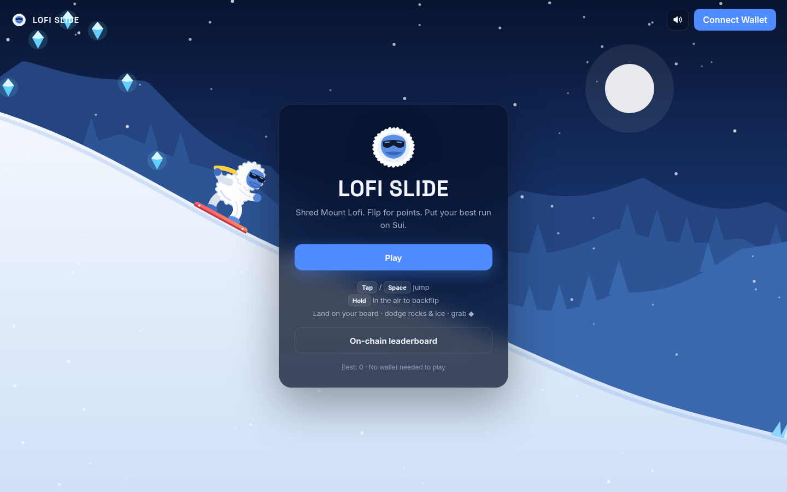
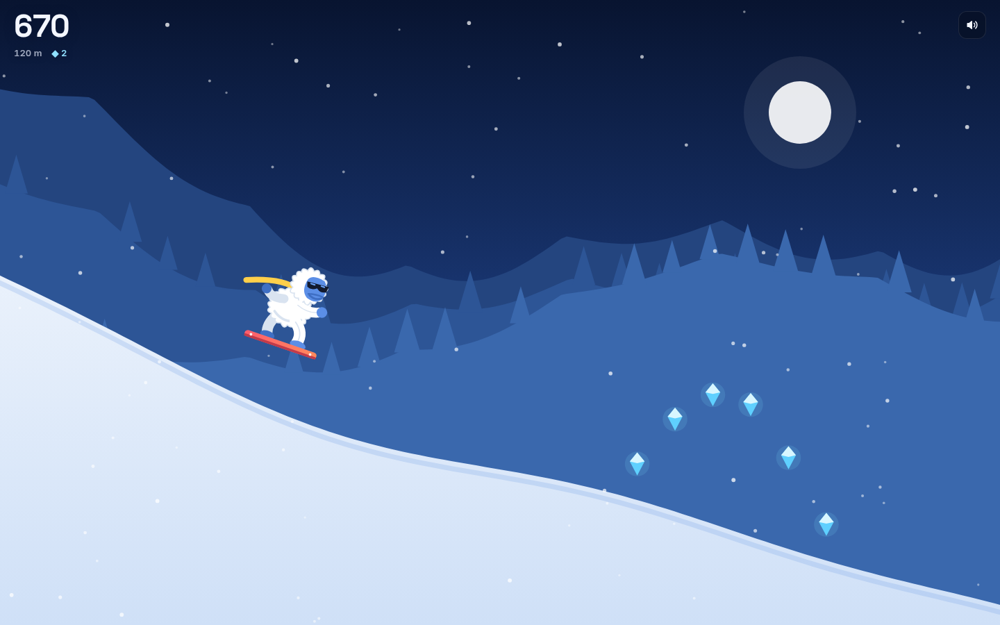
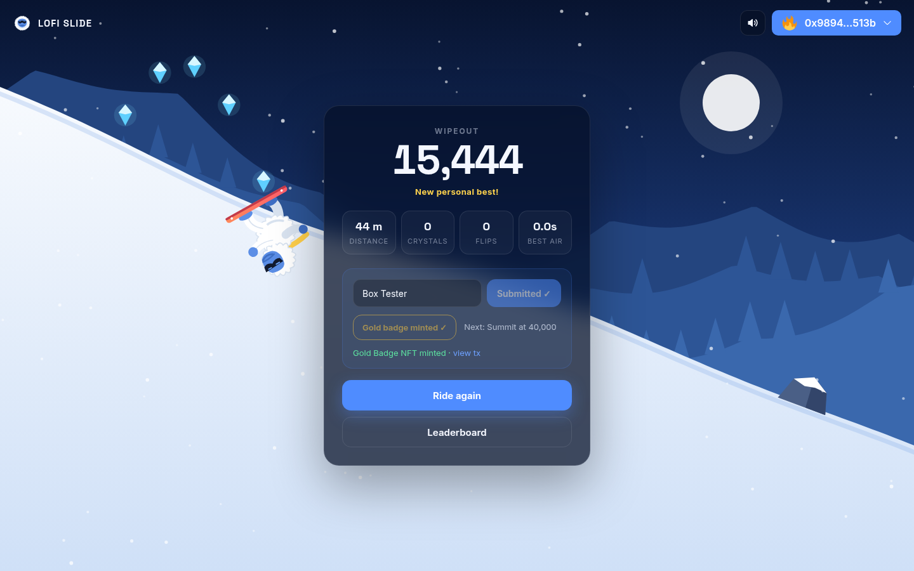

<p align="center"></p>

# Lofi Slide

**Shred Mount Lofi as Lofi the Yeti, flip for points, and put your best run on Sui.**

Lofi Slide is an endless snowboarding arcade game made for **CLAY Hackathon III** (mini-game track). It runs in any desktop or mobile browser. You don't need a wallet to play. If you connect a Sui wallet, you can post your run to an **on-chain leaderboard** and mint a **Summit Badge NFT**, written in Move and deployed on **Sui testnet**.

| Title | Gameplay | On-chain game over |
|---|---|---|
|  |  |  |

---

## How to play

| Action | Desktop | Mobile |
|---|---|---|
| Jump | `Space` / `↑` / `W` | Tap |
| Backflip | Hold while in the air | Hold while in the air |
| Start / restart | `Space` / `Enter` | Tap **Play** |

- **Land on your board.** If you come down at a bad angle, you wipe out. When you let go in the air, Lofi slowly levels out, so short hops are forgiving.
- **Rocks and ice spikes** end your run. Jump over them.
- **Blue crystals ◆** are worth 25 points times your combo.
- **Backflips** are worth 250 points × flips × combo. A *clean* landing (nearly flush with the slope) doubles that.
- **Combos** stack with every flip, up to ×10. A real jump that lands without a flip resets the combo.
- **Big air** (1.1 s or more in the air) gives bonus points.
- Each metre you travel adds 1 point. The slope gets steeper and faster the further you go.

## Features

- Hand-built canvas engine with sub-stepped slope physics, crest take-offs, flips with landing checks, and a speed curve that keeps getting harder.
- All Lofi art is **original procedural vector art** drawn for this game: white fur, blue face, hands and feet, dark shades, and a yellow scarf. The game loads no sprite files.
- Polish: particles, snow spray, screen shake, score popups, parallax mountain ranges with pine silhouettes, and falling snow.
- **Generated audio** made with WebAudio, so the game ships no audio files. It plays a mellow lo-fi chord loop (it's Lofi, after all) and has sound effects for jumps, crystals, flips and crashes. You can mute it, and the setting is remembered.
- Responsive layout: the camera zoom adapts to landscape desktops and portrait phones. Touch, mouse and keyboard all work.
- A clean glass UI using Inter and Space Grotesk.

## Built on the Sui Stack

```
Browser (React + Canvas)
 ├─ gameplay ── fully off-chain, no wallet needed
 └─ @mysten/dapp-kit-react ── Connect Wallet (Slush & any Wallet-Standard wallet)
       │  signAndExecuteTransaction (PTB)
       ▼
 Sui testnet ── package lofi_slide::leaderboard (Move 2024)
       ├─ Leaderboard (shared object): top-10, personal bests (Table), minted tiers (Table), total runs
       ├─ submit_score(name, score, distance, Clock)  → emits ScoreSubmitted
       ├─ mint_badge_to_sender()                       → SummitBadge NFT, emits BadgeMinted
       └─ Display V2 (DisplayRegistry 0xd) → badge name / description / on-chain SVG image
 Reads: SuiGrpcClient.core.getObject(...) → live leaderboard, with no wallet needed
```

### Deployed on Sui testnet

| | ID |
|---|---|
| **Package ID** | `0x5c0511a014bfef0372068c83efc94482defd70fdf7c9add1ce786897f8afa13d` |
| Leaderboard (shared object) | `0x316fa5f380dea9d20d3bde14b79a0c49444ec043c6eac74a94dfd4db8631e5e1` |
| Publish tx | `x3EgoHfMu68W6XFZWp9AoPfMf8yDkxRGCcKVKeFiXTW` |

Explorer: [package](https://suiscan.xyz/testnet/object/0x5c0511a014bfef0372068c83efc94482defd70fdf7c9add1ce786897f8afa13d) · [leaderboard](https://suiscan.xyz/testnet/object/0x316fa5f380dea9d20d3bde14b79a0c49444ec043c6eac74a94dfd4db8631e5e1)

### Move package (`move/lofi_slide`)

- **`Leaderboard`** is a shared object. It holds a sorted top-10 with at most one entry per player, plus a `Table<address, u64>` of every player's personal best. Only improvements update your best or your rank.
- **`SummitBadge`** is a `key + store` NFT with four tiers: **Bronze** at 1,000, **Silver** at 5,000, **Gold** at 15,000 and **Summit** at 40,000. Minting checks your **on-chain** personal best, so you have to submit a run before you can mint. Each tier can be minted only once per player, and you can always move up to a higher tier. The badge image is an SVG data URI stored on-chain, so it renders in wallets with no off-chain hosting.
- **Events:** `ScoreSubmitted` (player, name, score, distance, new_best, rank) and `BadgeMinted`.
- **Display V2:** after publishing, `setup_display(AdminCap, DisplayRegistry)` registers the NFT metadata through the new `sui::display_registry`.
- **Unit tests** cover ranking, dedup, the top-10 cap and the one-mint-per-tier rule.

> **Trust model (hackathon scope):** scores are reported by the client, as in most web arcade leaderboards. The contract caps obviously impossible scores and keeps only one best per address, but a determined cheater could still post a fake score. Possible hardening: a server-signed run attestation checked on-chain with `ed25519_verify`, or replay verification from a recorded input log stored on Walrus. See *Roadmap*.

## Run it locally

```bash
npm install
npm run dev        # http://localhost:5173
npm run build      # production bundle in dist/
npm run preview    # serve dist/
```

Requirements: Node 20 or later. To use the on-chain features, install a Sui wallet such as [Slush](https://slush.app), switch it to **Testnet**, and get test SUI from the [faucet](https://faucet.sui.io).

**Demo/test mode:** open the game with `?burner` (for example `http://localhost:5173/?burner`) to turn on dApp Kit's in-browser *Unsafe Burner Wallet*. Send it a little testnet SUI and you can try submit and mint without installing anything.

## Deploy

**Frontend:** the app is a static site, so any static host works.

- **Vercel / Netlify:** build command `npm run build`, output folder `dist`.
- **GitHub Pages:** copy `docs/github-pages-workflow.yml` to `.github/workflows/pages.yml`. It builds with `VITE_BASE=/<repo-name>/` and deploys. Then turn it on under *Settings → Pages → Source: GitHub Actions*.

**Move package** (Sui CLI 1.84 or later):

```bash
cd move/lofi_slide
sui move test
sui client switch --env testnet
sui client faucet
sui client publish --gas-budget 200000000
# then, with the AdminCap id from the publish output:
sui client call --package <PACKAGE_ID> --module leaderboard --function setup_display \
  --args <ADMIN_CAP_ID> 0xd --gas-budget 50000000
```

Put the new `PACKAGE_ID` and `LEADERBOARD_ID` into `src/sui/config.ts`.

## Project structure

```
src/
  game/engine.ts      game loop, physics, spawning, rendering
  game/lofi.ts        original procedural Lofi the Yeti vector art
  game/audio.ts       WebAudio music + SFX synth
  sui/config.ts       dApp Kit + gRPC client, package/object IDs
  sui/leaderboard.ts  PTB builders, on-chain reads, error mapping
  App.tsx             menus, HUD, wallet flow, leaderboard
move/lofi_slide/      Move package + unit tests
docs/                 logo + screenshots
```

## Roadmap

- Verified runs: deterministic seeds, input logs on **Walrus**, and attestation checks on-chain.
- Weekly seasons, with the leaderboard reset by the AdminCap and prizes for the top runs.
- Unlockable boards and scarves as on-chain cosmetics.
- A mainnet deployment.

## Credits

Made for CLAY Hackathon III (Code Like A Yeti), hosted by the Lofi Foundation. Lofi the Yeti is the Lofi community mascot. All art, audio and code in this repo are original.

MIT licensed.
